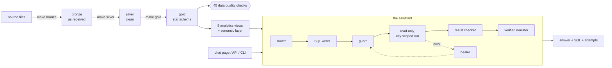

# Swiggy AI Data Assistant

Ask business questions in plain English ("Why did refunds increase in Mumbai last month?"). A
multi-agent system answers from a properly built Postgres warehouse, **shows the SQL it used**,
**repairs its own failed queries**, **catches answers that run fine but are wrong**, and never exposes
personal data. It runs on your laptop; the only paid part is the OpenAI calls. All data is generated
sample data (seed 42): nothing is real.

Built phase by phase for the YouTube channel *Agentic Data Lab*. Every phase has a short note in
[`notes/`](notes/) with what was built, why it matters at work, the commands, common mistakes and an
interview line.

## What it does

- **A real warehouse:** bronze (as received) -> silver (clean) -> gold (star schema with a
  slowly-changing customer dimension and a monthly-partitioned orders fact), with 45 data-quality
  checks that can block publishing.
- **A semantic layer:** one SQL definition per metric, a catalog of every column the assistant may
  see, and a glossary, validated against the live database.
- **A multi-agent assistant:** router, planner, SQL writer, a parser-based guard, a healer, a result
  checker and a narrator whose numbers are verified against the rows.
- **Defence in depth:** a read-only role limited to eight views, row-level security per city, session
  limits, personal data kept out of reach, and an audit trail with personal data scrubbed.
- **Operations:** schema-drift quarantine, `make daily` with a stop sign, a scheduler, an answer cache.
- **Evaluation:** thirty golden questions with independently written reference SQL.
- **Three ways in:** a chat page, an HTTP API, and a command line.

## Architecture



Four detailed diagrams (data flow, the agent graph, security layers, the request path and daily run)
are in [`docs/architecture.md`](docs/architecture.md); the star schema is in
[`docs/erd.md`](docs/erd.md).

## Prerequisites

- Docker Desktop (running)
- Python 3.11 or newer (developed on 3.11, and the quick start was also run on 3.14)
- An OpenAI API key. Set a usage limit in the OpenAI dashboard first, and use small, cheap models.

## Quick start

Copy and paste, one step at a time. Everything is idempotent, so you can re-run any step.

```bash
make venv                              # 1. create .venv and install the requirements
make env                               # 2. create .env, then edit it (see below)
make up                                # 3. start Postgres 16 and wait until it is healthy
make check                             # 4. verify .env, the database, the roles and one tiny model call
make data                              # 5. generate the sample data into data/raw (a few seconds)
make bronze silver-full gold-full      # 6. load, clean and model it (under a minute)
make dq                                # 7. run the 45 data-quality checks
make security seed-users               # 8. roles, row-level security, then the three demo users
make ask Q="How many orders did we get last week?" WHO=admin   # 9. ask from the terminal
make ui                                # 10. open the chat page at http://localhost:8501
```

**In step 2, edit `.env`:** set `OPENAI_API_KEY`, `OPENAI_MODEL` (and optionally `OPENAI_MODEL_LOW`,
`_MEDIUM`, `_HIGH` to use a cheaper model for routing and wording), and replace the three example
`API_KEY*` values with your own (at least 16 characters). `.env` is git-ignored: never commit it.

## Run the demo

Each of these has been run for real. The first three are the ones worth filming.

| Show | Run | What you see |
|---|---|---|
| A multi-step "why" question | `make ui`, then *Why did refunds increase in Mumbai last month?* | the planner splits it into steps; the answer finds the spoiled-food refunds and the restaurants behind them, with SQL and data for every step |
| The assistant fixing itself | `DEMO_FAULT_INJECTION=true make ask Q="What is our total net revenue?"` | "Attempt 1 failed: column total_amount does not exist -> The healer rewrote the query -> Attempt 2 succeeded". The fault is labelled everywhere, is off by default, and is never on during `make eval` |
| City scoping | ask *How many orders did we get last week?* as `admin`, then `WHO=bengaluru_manager` | different numbers, because the database only returns the manager's city |
| A wrong table is caught | `make dq-demo` | a copy of gold gets a day loaded twice; the checks catch it, real gold is untouched |
| A source changes its schema | `make drift-demo` | quarantined, alerted, then loaded after the owner approves the rename |
| The database on screen | `make pgadmin`, then follow [`docs/db_tour.md`](docs/db_tour.md) | the layers from raw files to star schema, and what the AI is (not) allowed to see, in pgAdmin |
| Trying to break out | `make security-demo` | each attempt to read raw tables, write, or widen the scope fails |
| The audit trail | `make report` | success, heal and refusal rates, guard rejections, tokens and cost |
| Measuring it | `make eval` | scores 30 golden questions (calls OpenAI; costs a little) and writes a report |

## Make targets

Run `make` to list them. `test-NN` below stands for `test-00` to `test-14`.

| Setup | |
|---|---|
| `make venv` | create `.venv` and install requirements |
| `make env` | create `.env` from `.env.example` if missing |
| `make up` / `make down` | start / stop Postgres (data is kept) |
| `make reset-db` | **danger:** delete the database volume and start fresh |
| `make psql` | open a `psql` shell as admin |
| `make pgadmin` / `make pgadmin-down` | start / stop pgAdmin, a web UI for the database, at http://localhost:5050 (the first run downloads its image) |
| `make pgadmin-reset` | forget pgAdmin's saved settings (saved passwords, renamed connections) |
| `make check` | verify env, database, roles and one tiny model call |

| Data pipeline | |
|---|---|
| `make data` | generate deterministic sample data into `data/raw` |
| `make bronze` | load new source files (skips files already loaded) |
| `make bronze-reset` | forget all loaded bronze data, then reload from `data/raw` |
| `make bronze-rerun-test` | load twice; fail unless the second run loads nothing |
| `make silver` / `make silver-full` | clean new bronze batches / rebuild silver from all of bronze |
| `make gold` / `make gold-full` | load new silver data / rebuild the star schema |
| `make views` | (re)create the analytics views the assistant reads |
| `make daily` | bronze, silver, gold, quality checks, then (if healthy) refresh the catalog and publish |
| `make scheduler` | run `make daily` every day at 06:00 India time (Ctrl+C to stop) |

| Quality, catalog and drift | |
|---|---|
| `make dq` | run all data-quality checks (exit 1 if a blocking one fails) |
| `make dq-demo` | corrupt a copy of gold and show the checks catch it |
| `make catalog-check` | fail if a view column is missing from `semantic/catalog.yml` |
| `make refresh-catalog` | update `catalog.yml` from the database and list what needs a description |
| `make drift-demo` | a source renames a column: quarantine, alert, approval |

| Security | |
|---|---|
| `make security` | roles, grants, row-level security, session limits, then verify them |
| `make security-verify` | check the live database's security posture (exit 1 on a problem) |
| `make seed-users` | create the demo users from the keys in `.env` |
| `make security-demo` | log in as the assistant and try to break out |

| Using and operating the assistant | |
|---|---|
| `make ui` | the chat page, http://localhost:8501 |
| `make api` | the HTTP API, http://127.0.0.1:8000 (docs at `/docs`) |
| `make ask Q="..." WHO=admin` | ask from the terminal |
| `make report` | how the assistant did over the last 7 days |
| `make cache-clear` | forget every cached answer |

| Evaluation | |
|---|---|
| `make eval` | ask all 30 golden questions with the real model and score them |
| `make eval-check` | validate the golden set and every reference query (no model call) |
| `make eval-compare` | what changed between the last two runs |
| `make eval-gate` | exit non-zero if the latest run misses the pass marks you set |

| Tests | |
|---|---|
| `make lint` | ruff |
| `make test-NN` | the tests for one phase |
| `make test` | all tests |
| `make ci` | lint + all tests (live tests skip without a key) |

## Folder tour

| Path | What is in it |
|---|---|
| `src/swiggy_ai/datagen/` | the seeded data generator and its injected defects |
| `src/swiggy_ai/pipeline/` | bronze loader, silver, gold, schema drift, daily run, scheduler |
| `src/swiggy_ai/dq/` | the data-quality checks and runner |
| `src/swiggy_ai/semantic/` | loader, context builder, catalog check and refresh |
| `src/swiggy_ai/security/` | the SQL guard, city scoping, users, security setup |
| `src/swiggy_ai/agents/` | the graph and every agent; prompts are in `agents/prompts/*.md` |
| `src/swiggy_ai/ops/` | audit trail, cost, report, answer cache |
| `src/swiggy_ai/api/`, `ui/`, `cli.py` | the three ways in; `presentation.py` explains an answer |
| `sql/` | all DDL, by layer: `bronze silver gold ops security` |
| `semantic/` | `metrics.yml`, `catalog.yml`, `glossary.md` |
| `eval/` | golden questions, reference SQL, judge, runner, report |
| `orchestration/airflow/` | a teaching-only Airflow version of `make daily` |
| `docs/` | architecture, ERD, database tour, interview cheatsheet |
| `notes/` | one short note per phase |
| `tests/` | `phase00` to `phase14` |

## Troubleshooting

- **`role "assistant_ro" does not exist`, or the wrong database answers:** another Postgres is on the
  port. This project uses host port **5433** (not 5432). Check `POSTGRES_PORT` and the `DATABASE_URL_*`
  ports in `.env` agree.
- **Cannot reach the database:** start Docker Desktop, then `make up`.
- **Changed passwords in `.env`:** roles are created only on first start. Run `make reset-db`.
- **`make check` fails on the model call:** check `OPENAI_API_KEY` and that `OPENAI_MODEL` is a model
  your account can use. Nothing else needs the key except asking questions and `make eval`.
- **The chat page says "No users yet":** run `make seed-users` (after `make security`).
- **Every request gets 401:** the key must be the one in `.env` at the time you ran `make seed-users`;
  re-run it after changing a key.
- **A file is "waiting in quarantine":** its columns changed. See `ops.schema_alerts`, edit
  `src/swiggy_ai/pipeline/column_aliases.yml`, run `make bronze` (read `notes/chapter_11.md`).
- **`make daily` says it was blocked:** a blocking data-quality check failed; run `make dq` to see which.
- **Old answers after editing a prompt:** run `make cache-clear` (the cache ignores prompt changes).
- **Cost shows "not computed (prices not set)":** set `PRICE_INPUT_PER_1M` and `PRICE_OUTPUT_PER_1M`
  from your provider's pricing page. Prices are never guessed.
- **Port 8000 or 8501 is taken:** stop the other program, or run uvicorn / streamlit with another port.
- **pgAdmin says a newer version is available:** harmless. The image is pinned (`dpage/pgadmin4:9.9`) so the setup stays reproducible; close the banner, or raise the version in `docker-compose.yml` if you want the latest.

## About the data

Everything is generated, nothing is real. `make data` writes source-system style files to `data/raw/`
with deliberate defects (duplicates, messy status spellings, a time-zone mix-up, missing cities) and a
ledger of what it injected in `data/raw/_defects.json` (see `notes/chapter_01.md`). A few rows of each
file type are in `data/sample/`.

## Evaluation, honestly

`make eval` asks the 30 questions in `eval/golden.yml` and scores each answer against a reference query
written on the gold tables, independent of the views the assistant reads. It writes a report to
`eval/results/` (not committed). **This README states no accuracy figure on purpose: run `make eval` and
read your own report.** The gate's pass marks are in `eval/thresholds.yml` (strict on refusals, clarifications and
security; change them only after reading a run) and it refuses to decide on a partial run. See `notes/chapter_10.md`.

## What this is not

A teaching project, not a product. The chat page has no login. The API has no rate limiting or HTTPS.
Conversation memory is lost when the process restarts. A small model can still write a wrong query that
passes every check; that is what the evaluation is for. Rotate your OpenAI key when you are done filming.

## Where to read more

[`docs/architecture.md`](docs/architecture.md) · [`docs/erd.md`](docs/erd.md) ·
[`docs/db_tour.md`](docs/db_tour.md) · [`docs/interview_cheatsheet.md`](docs/interview_cheatsheet.md) · [`notes/`](notes/) (chapters 00 to 14)
