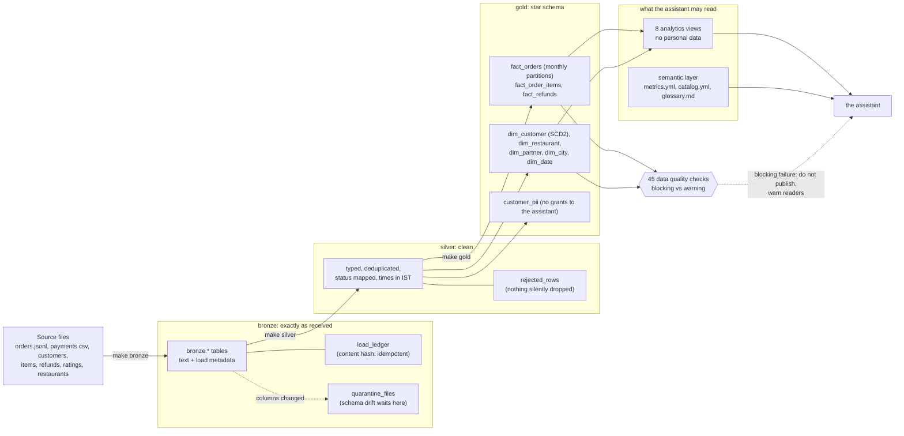
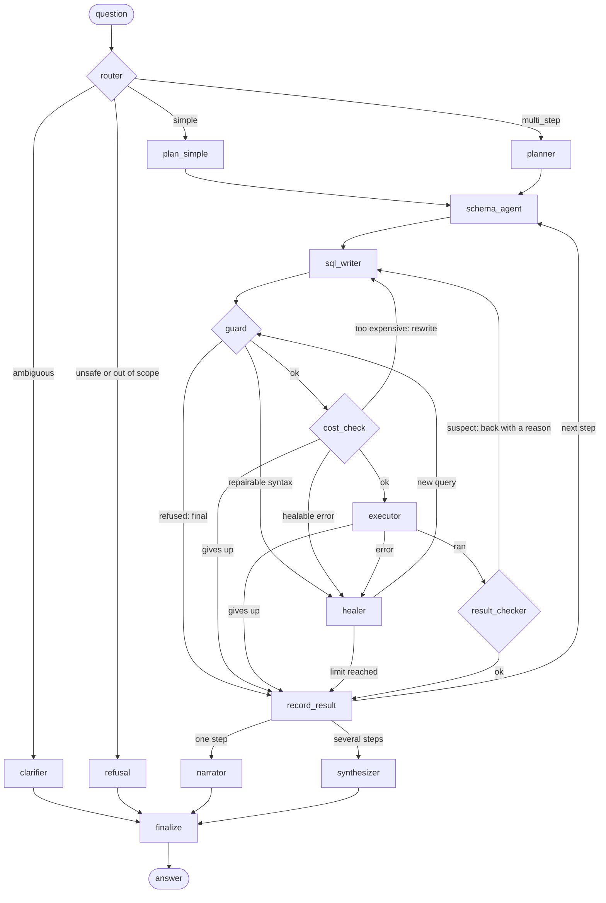
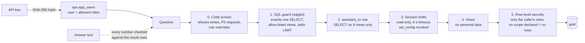
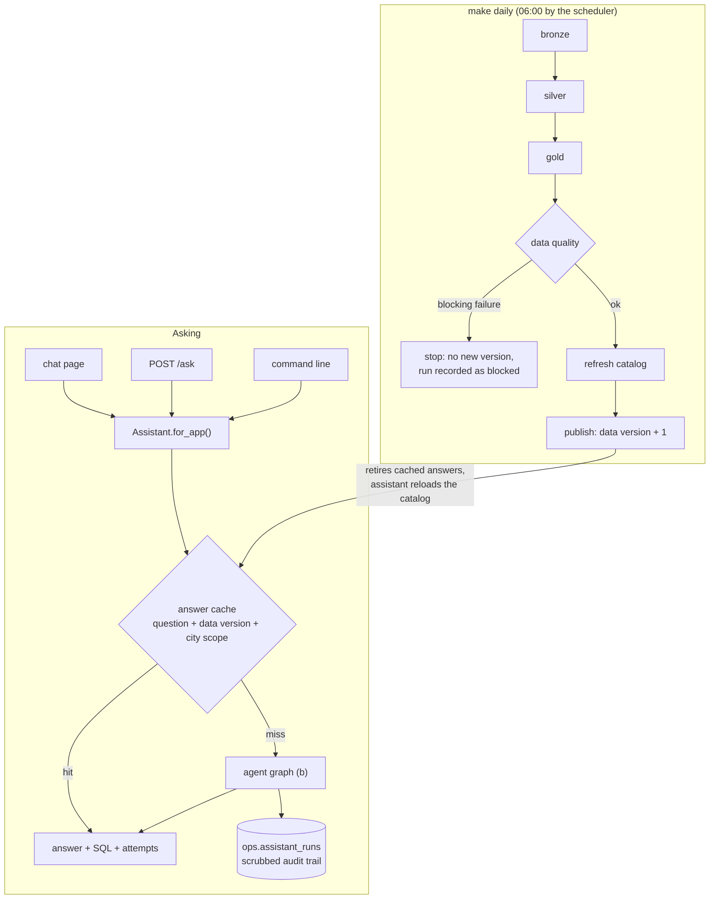

# Architecture

Four pictures: how data flows, how a question is answered, how access is limited, and how a
request and the daily run fit together. Every box is a real file or table; the agent-graph
picture is checked against the compiled graph by a test, so it cannot drift from the code.

## a) Data flow: sources to answers

Each stage keeps its own high-water mark (`ops.pipeline_state`), so a run only touches new
batches. `make daily` runs the whole chain and stops before publishing if a blocking check fails
(see d).

## b) The agent graph (one question)

The router, clarifier, planner, SQL writer, healer, narrator and synthesizer use a model. The
guard, cost check, executor, result checker, schema agent and every routing decision are plain
code. The model proposes; code decides.

## c) Security layers

| Layer | Where |
|---|---|
| Code screen | `agents/router.py` |
| SQL guard | `security/sql_guard.py`, `agents/guard_node.py` |
| Role and grants | `sql/security/00_roles.sql` (grants follow `semantic/catalog.yml`) |
| Session limits | `ALTER ROLE assistant_ro SET ...` |
| Views | `sql/security/10_analytics_views.sql` |
| Row-level security | `sql/security/05_rls.sql`, `security/scope.py` |
| Verifier | `make security-verify` fails if any layer is weakened |

## d) A request, and the daily run

`ops.pipeline_runs` records every daily run, including the blocked and failed ones.
