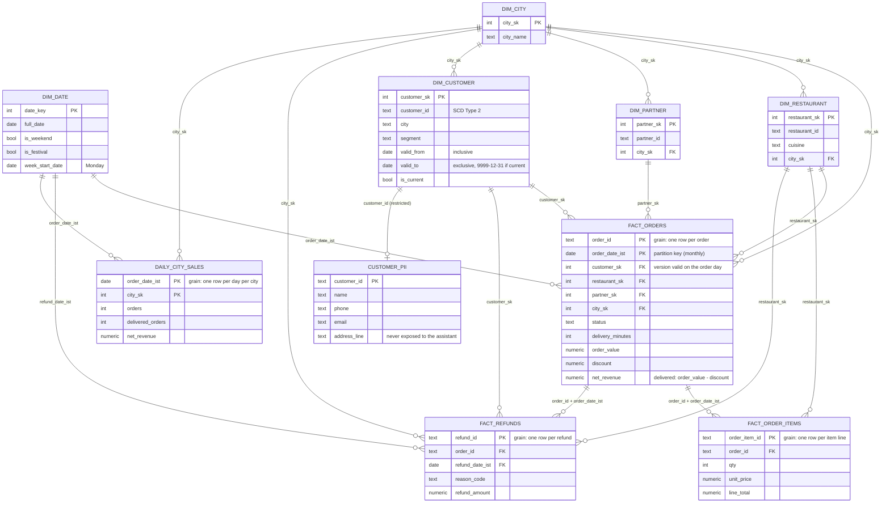

# Gold star schema

Key columns are shown, not every column (a test checks each one exists in the database). Facts are events. Dimensions describe who, what, where and when. Every fact row points at one
dimension row through a surrogate key (`*_sk`). `-1` is the "Unknown" member, used when a fact
cannot find its dimension row, so nothing is dropped.

## Grains (what one row means)

| Table | One row per |
|---|---|
| `fact_orders` | order |
| `fact_order_items` | item line on an order |
| `fact_refunds` | refund |
| `daily_city_sales` | IST day per city |
| `dim_customer` | customer per period with the same city and segment |

**Why grain matters:** summing `order_value` over `fact_order_items` repeats each order's value
once per line. Aggregate items first, or use `fact_orders`. The semantic layer (chapter 6)
carries this warning to the assistant.
