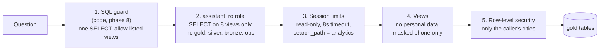

# Chapter 07: Security

**What we build:** five independent layers between the assistant and the data, so no single
mistake (a bad prompt, a clever SQL string, a forgotten grant) exposes anything.

| Layer | What it stops | Where |
|---|---|---|
| Role privileges | reading raw layers or `customer_pii`; any write, DDL, `COPY`, new schema | `sql/security/00_roles.sql`, grants from `catalog.yml` |
| Session defaults | long queries (`statement_timeout`), idle transactions, escaping the search path, writes by default | `ALTER ROLE assistant_ro SET ...` |
| Views | personal data in results | `sql/security/10_analytics_views.sql` |
| Row-level security | seeing another city's rows | `sql/security/05_rls.sql` |
| `set_config` revoked | widening the city scope from inside a query | `00_roles.sql` |

**Least privilege, concretely.** `assistant_ro` can `SELECT` from exactly the 8 views listed in
`semantic/catalog.yml`. A ninth view someone creates is unreadable until it is documented and
granted. It has no right on any other schema, cannot create anything, and has no superuser,
`BYPASSRLS` or `CREATEROLE` powers. The pipeline role (`etl_writer`) owns the data; the
assistant never touches it.

**How can it read gold through views without access to gold?** A view runs with its owner's
rights. The owner is `etl_writer`, so the assistant needs only `SELECT` on the view. That is
also why row-level security needs `FORCE`: the owner would otherwise skip the policy.

**City scoping (row-level security).**
- A restricted session must declare its scope: `SET app.allowed_cities = 'ALL'` or
  `'Pune,Mumbai'`. The API sets it from the caller's identity.
- **No scope declared means no rows.** It fails closed.
- The rule reads `session_user` (the login), not `current_user`, because inside a view
  `current_user` is the view owner.
- A role's ceiling in `ops.role_city_access` caps what it can ask for. Direct database users
  (the `analyst_city_role` pattern) cannot `SET` their way past it.
- It covers orders, items, refunds, restaurants, the daily aggregate and (through the view)
  customers. The pipeline and admin sessions are never scoped.

**API keys.** `ops.app_users` maps a key to a user and cities. Only the SHA-256 hash is
stored. Keys under 16 characters are refused, unknown cities are an error (a typo can never
silently widen or empty someone's view), and deactivating a user locks them out immediately.

**What the tests try, and fail, to do** (`make test-07`, 141 tests):
read every raw table and a gold partition; run 16 kinds of write and DDL (including `COPY ...
TO PROGRAM`, `CREATE EXTENSION dblink`, `CREATE ROLE`); call `set_config`, `pg_read_file`,
`lo_import`; sleep for four times the timeout; set the search path to gold; ask for all cities
while scoped to one; join other cities in; declare a scope containing a quote and a `DROP`; and
search every row of every view for any real customer's name, email, address or phone. Then they
weaken the setup 12 different ways (grant on bronze, disable RLS, remove a policy ...) and check
that `make security-verify` notices each one.

**Honest limits**
- The assistant's own scope is a session setting, and one login serves every user. Inside that
  session the database cannot tell the application's `SET app.allowed_cities` from a malicious
  one. We close the function route (`set_config` is refused) and the phase 8 guard allows only a
  single `SELECT`, so `SET` never reaches the database. If you need more, give each scope its
  own login role: that is what the ceiling table is for.
- Row-level security filters rows, not columns. Personal data is kept out by the views and by
  `customer_pii` having no grants, not by RLS.

**Commands:** `make security`, `make security-verify`, `make seed-users`, `make security-demo`,
`make test-07`

**Common mistakes**
- Giving the assistant the same login as the pipeline "to keep it simple".
- Row-level security without `FORCE` when views are involved: it silently does nothing.
- A policy that treats "no scope" as "everything". Fail closed.
- Using `pg_has_role` to detect restricted users: it returns true for every superuser, so the
  admin got locked out of its own views. A test found it.
- Putting the real API key in the database. Store the hash.

**Interview line:** "I layer the controls: a read-only role limited to documented views,
session limits, views that contain no personal data, and row-level security that fails closed.
Each layer is tested by trying to break it, and a verifier fails the build if any layer is
weakened."
