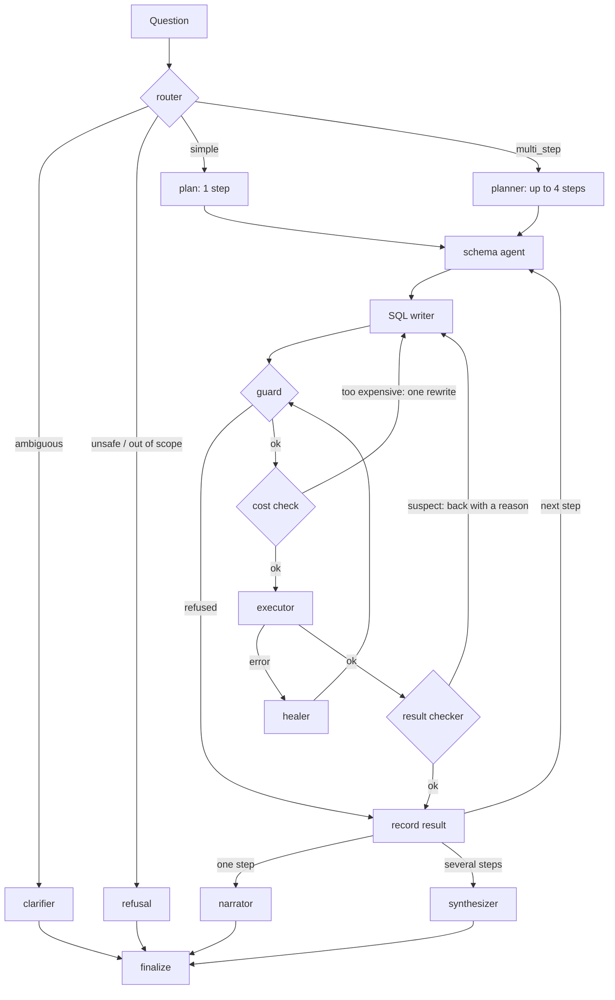

# Chapter 08: The multi-agent system

**What we build:** a LangGraph graph that answers a plain-English question from the warehouse,
shows the SQL it used, repairs its own failed queries, catches answers that are silently wrong,
and refuses what it must refuse. Built in four increments, each tagged: `chapter-08a` ... `08d`.

| Increment | Adds |
|---|---|
| 08a | schema agent, SQL writer, **guard**, cost check, executor, narrator that proves its numbers |
| 08b | **healer** (self-healing) and demo-only fault injection |
| 08c | **result checker**: join fan-out, wall-clock dates, unanchored periods, odd values |
| 08d | router, clarifier, planner, synthesizer, conversation memory |

**Which parts use a model.** Router, clarifier, planner, SQL writer, healer, narrator and
synthesizer do. The guard, cost check, executor, result checker, schema agent and all the
routing decisions are plain code. The cheap model (`OPENAI_MODEL_LOW`) does routing, clarifying
and narrating; the stronger one (`OPENAI_MODEL_MEDIUM`) writes and repairs SQL and plans. A
typical question uses about 2,500 input tokens; a three-step "why" question about 9,000.

**The guard (`security/sql_guard.py`).** Deterministic, using `sqlglot`. A query passes only if
it is exactly one SELECT with nothing that changes anything anywhere inside it, reads only the
documented views, calls no function on the deny list (sleep, file access, settings, `dblink`,
`query_to_xml` ...) and contains no comments. It then adds `LIMIT 500`. 126 tests attack it.
It runs the re-written SQL, so what it approved is exactly what runs. A refusal is final:
**the healer never sees it**. The one exception is a query that simply does not parse, which is an
ordinary mistake and is repaired.

**The healer.** Repairs the six ordinary mistake classes (syntax, unknown column or table,
ambiguous column, type mismatch, grouping error) with the smallest change, shown the exact
database error and the documentation of the views involved. It stops at `MAX_HEAL_ATTEMPTS`
per step, or when it proposes a query it already tried (even one that is only formatted
differently). A timeout gets one attempt with a "do less work" hint. Permission errors and
guard refusals are never repaired.

**The result checker.** The dangerous failures give no error.
- *Join fan-out:* orders joined to order items, then an order-level figure summed. The check
  runs a trusted control query on `analytics.orders` alone with the same filters, as the same
  city-scoped user, and compares totals. On the real data the trap inflates revenue by more than
  2.5x. The writer is sent back with both numbers.
- *Wall clock:* `CURRENT_DATE`/`NOW()` against data that stops on a fixed day.
- *Unanchored period:* "last month" answered without `data_as_of`.
- *Odd values:* empty or all-null results, negative revenue, rates outside 0 to 1, a row cap.
  These are warnings, not rewrites.

**Verified narration.** After the narrator writes, every number in its text is looked up in the
result rows (rounded figures and percentages of ratios are accepted). One firm retry, then plain
figures from the data, with a warning. The assistant never publishes a number that is not in
the data.

**Demo-only fault injection.** `DEMO_FAULT_INJECTION=true` breaks the first query of a run
(`eval/fault_injection.yml`) so the healing is easy to show: the model's own query gets a wrong
column, or a SQL Server date function. It is off by default, it is flagged in the answer, the
warnings and the log, and `make eval` never turns it on.

**Conversation memory.** A LangGraph checkpointer keyed by `thread_id` keeps the history. "And
in Pune?" is rewritten into a full question by the router. The per-turn fields are reset every
turn so nothing leaks from one question to the next.

**Refusals do not depend on a model.** A code screen catches requests to delete or change data,
to reveal customers' phone numbers, emails, addresses or names, and attempts to override the
rules. Counting questions ("how many customers have a phone number?") pass. The model's
rewrite of a follow-up is screened too.

**Commands:** `make test-08` (306 offline tests, no key needed); live tests run with a key.

**Honest limits**
- The check for a missing date filter is a heuristic on the SQL. It looks for a comparison of a
  date column with a value or a computed bound. Live runs found two false alarms (a filter
  inside `FILTER (WHERE ...)`, and bounds computed in a CTE); both are fixed and tested.
- A small model can still write a wrong query that passes every check. That is what the
  evaluation in chapter 10 measures.
- The in-memory checkpointer forgets conversations when the process restarts.

**Common mistakes**
- Letting the same model that wrote the SQL also vouch for it. Checks should be code.
- Healing everything. A refusal that gets "fixed" is a hole.
- Counting `CURRENT_DATE` as harmless. It silently gives empty answers on a fixed dataset.
- Trusting a narrator. Check its numbers against the rows.

**Interview line:** "The model proposes, deterministic code disposes: a parser-based guard
before the database, a read-only scoped role in it, a control-total check after it, and a
narrator whose numbers are verified against the result."
